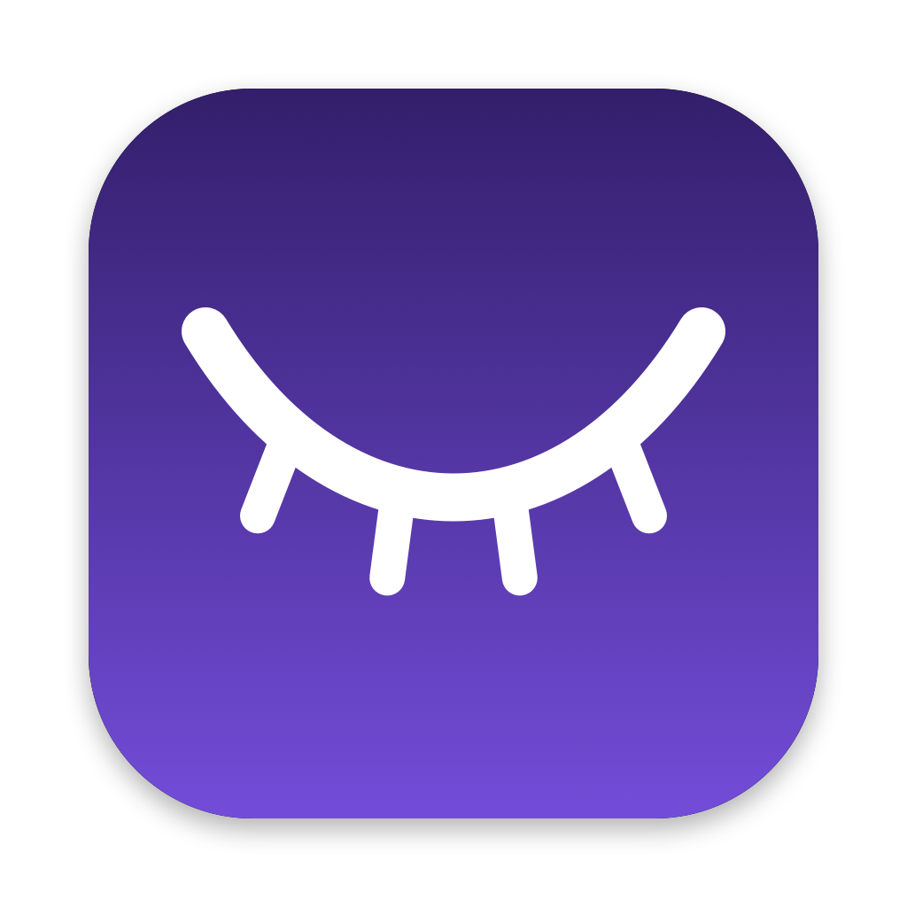

<p align="center"></p>
<h1 align="center">Dozer</h1>
<p align="center">Keeps your Mac awake while your work runs (exports, renders, file transfers, builds, AI agents), then lets it sleep the moment it's done.</p>
<p align="center">
  <a href="https://github.com/sekophungula/Dozer/releases/latest/download/Dozer.dmg"><b>Download for macOS</b></a> ·
  <a href="https://dozer.shakatec.co.za">Website</a> ·
  <a href="https://dozer.shakatec.co.za/docs/">Docs</a>
</p>
<p align="center"><sub>Formerly Dozex, and before that Sleepable.</sub></p>

---

Dozer is a small menu bar app for macOS. While Final Cut Pro exports, Blender renders, files download, upload or copy to a drive, Claude Code works or any terminal command runs, it stops your Mac from idle-sleeping. When the work finishes it releases the hold, so your normal Energy settings apply again. No changing sleep settings and no leaving a movie playing to keep the Mac up.

## Features

- **Menu bar toggle.** An eye icon at the top of the screen shows the status and turns Dozer on or off.
- **Control Center control** (macOS 26+). Add *Dozer* in Control Center → Edit Controls.
- **App watching.** Final Cut Pro, Compressor, iMovie, Premiere Pro, Media Encoder, After Effects, DaVinci Resolve, HandBrake, Logic Pro, GarageBand, Ableton Live, Pro Tools, Photoshop, Lightroom, Blender, Cinema 4D, Unity, Unreal, Xcode and Android Studio keep the Mac awake while they're exporting, rendering or building. Add any other app on the setup page. Each app can be set to *When busy*, *While open* or *Off*.
- **File transfer watching.** Downloads and uploads in any app, network shares, cloud syncs, online backups, and copies to or from an external drive or SD card keep the Mac awake until they finish. Light traffic like music or messages doesn't count. Turn it off with *Watch File Transfers*.
- **Accurate Claude tracking** through Claude Code hooks, with a fallback that watches for busy `claude` processes.
- **Terminal watching.** A command running in any terminal (Terminal, iTerm, Ghostty, Warp, VS Code, tmux) keeps the Mac awake. CLI agents such as Codex, Gemini CLI and Aider, plus editors, `ssh` and REPLs, count only while they're using CPU, so an idle session doesn't keep the Mac up. A short CPU spike doesn't count: they need to keep working for about 10–15 seconds. Turn it off with *Watch Terminal*.
- **Grace period.** Stays awake for a configurable time after Claude finishes, so back-to-back prompts don't let the Mac drop off between them.
- **Keep awake indefinitely**, for when you want plain caffeinate-style behaviour.
- **Optional display-awake mode** and a **"done" notification**.
- **Open at login.**

## Install

1. Download `Dozer.dmg` from the [latest release](https://github.com/sekophungula/Dozer/releases/latest) and drag Dozer into Applications.
2. Dozer is ad-hoc signed and not notarized, so macOS blocks it the first time. Open **System Settings → Privacy & Security** and click **Open Anyway**, or run:
   ```bash
   xattr -dr com.apple.quarantine /Applications/Dozer.app
   ```
3. On the setup page, click **Connect Claude Code**.

## How it works

| Piece | What it does |
| --- | --- |
| `PowerAssertion` | Holds an IOKit `PreventUserIdleSystemSleep` assertion (the same mechanism `caffeinate` uses) and, if you choose, `PreventUserIdleDisplaySleep`. |
| `TerminalMonitor` | Every few seconds, reads `ps` and checks each terminal's foreground job. A non-shell command counts as work. Known agents and interactive programs count only while they stay above 3% CPU (summed over that terminal). |
| `AppMonitor` | Matches running apps against the watch list by bundle ID. An app set to *When busy* counts once it and the processes it started use 10% CPU or more for most of the last 15 seconds. *While open* counts as long as the app runs. |
| `TransferMonitor` | Reads the byte counters of the Mac's Wi-Fi and Ethernet connections and of external drives and SD cards (no permissions needed). 250 KB/s or more over the network, or 1 MB/s or more on an external drive, kept up for about 15 seconds, counts as a transfer. The Mac's own disk is left out. |
| `BusyTracker` | Smooths readings for apps, agents, `claude` processes and network traffic: busy after 4 of the last 5 readings are hot, idle again once at most 1 is. |
| `HookInstaller` | Adds hooks for `UserPromptSubmit`, `PreToolUse` and `PostToolUse` (mark busy) and for `Stop` and `SessionEnd` (mark done) to `~/.claude/settings.json`. Each hook calls a tiny shell script that creates or deletes a marker file per session in `~/Library/Application Support/Sleepable/sessions`. |
| `ClaudeMonitor` | Every 3 seconds it counts live session markers and `claude` processes that keep using CPU. Stale markers left behind by crashed sessions are cleaned up automatically. |
| `DozerControl.appex` | A WidgetKit `ControlWidgetToggle` for Control Center. It talks to the app through a small state file and Darwin notifications. |

Disconnecting from the setup page removes the hooks again. A copy of your original settings is saved as `~/.claude/settings.json.sleepable-backup`.

**Limitation:** a MacBook with its lid closed and no external display will always sleep. Keep the lid open for long runs.

## Build from source

You need Xcode 26 or later (for the Control Center extension SDK). No Xcode project is required:

```bash
Scripts/build.sh            # → build/Dozer.app
Scripts/build.sh --package  # → also build/Dozer.zip, build/Dozer.dmg and the legacy update zips
```

Set `VERSION=1.2.0` to stamp a version, or `SIGN_IDENTITY="Developer ID Application: …"` to sign with your own certificate.

## Website

The site at [dozer.shakatec.co.za](https://dozer.shakatec.co.za) is built from `website/src`:

```bash
python3 website/build.py              # → website/public
npx -y wrangler@4.166.0 deploy        # publish to Cloudflare
```

## License

MIT. Not affiliated with Anthropic.
