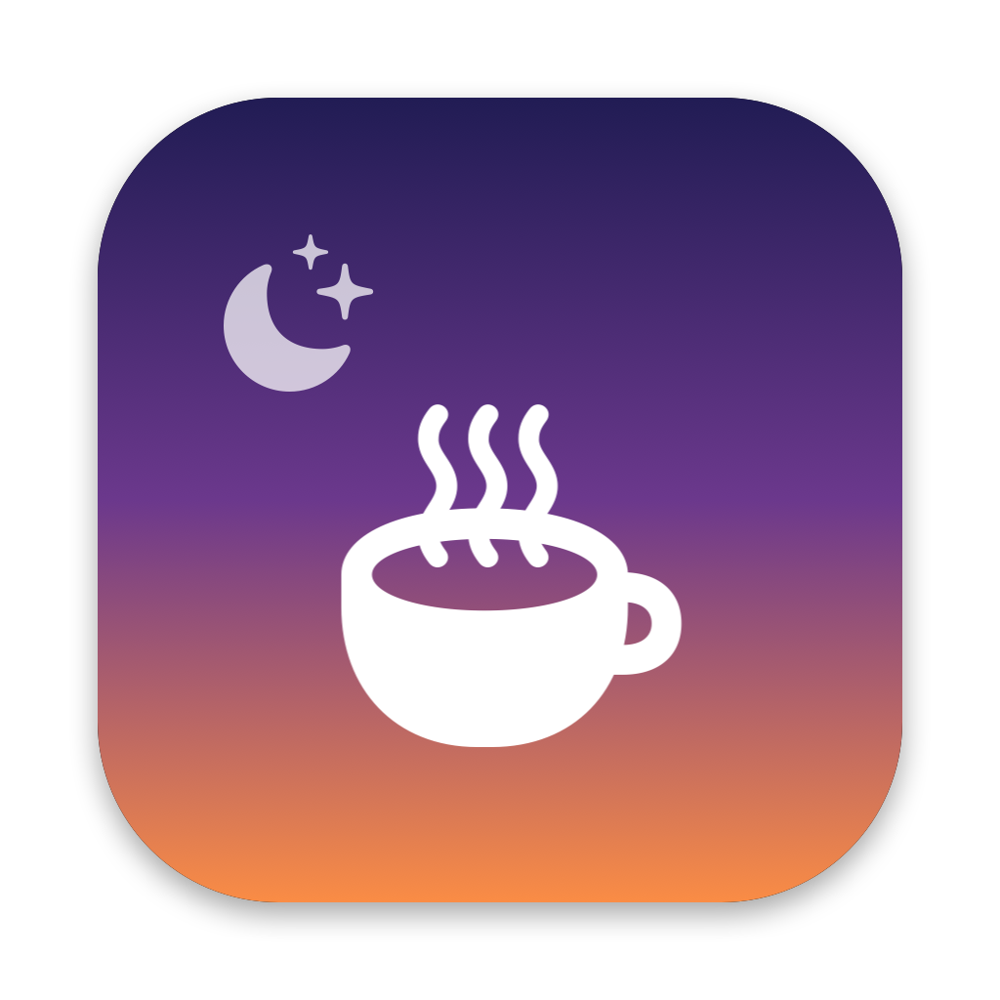

<p align="center"></p>
<h1 align="center">Sleepable</h1>
<p align="center">Keeps your Mac awake while Claude works, then lets it sleep the moment every task is done.</p>
<p align="center">
  <a href="https://github.com/sekophungula/Sleepable/releases/latest/download/Sleepable.dmg"><b>Download for macOS</b></a> ·
  <a href="https://sekophungula.github.io/Sleepable/">Website</a>
</p>

---

Sleepable is a small menu bar app for macOS. While a Claude Code task is running it stops your Mac from idle-sleeping. When the last task finishes it releases the hold, so your normal Energy settings apply again.

## Features

- **Menu bar toggle.** A cup icon at the top of the screen shows the status and turns Sleepable on or off.
- **Control Center control** (macOS 26+). Add *Sleepable* in Control Center → Edit Controls.
- **Accurate tracking** through Claude Code hooks, with a fallback that watches for busy `claude` processes.
- **Grace period.** Stays awake for a configurable time after Claude finishes, so back-to-back prompts don't let the Mac drop off between them.
- **Keep awake indefinitely**, for when you want plain caffeinate-style behaviour.
- **Optional display-awake mode** and a **"Claude is done" notification**.
- **Open at login.**

## Install

1. Download `Sleepable.dmg` from the [latest release](https://github.com/sekophungula/Sleepable/releases/latest) and drag Sleepable into Applications.
2. Sleepable is ad-hoc signed and not notarized, so macOS blocks it the first time. Open **System Settings → Privacy & Security** and click **Open Anyway**, or run:
   ```bash
   xattr -dr com.apple.quarantine /Applications/Sleepable.app
   ```
3. On the setup page, click **Connect Claude Code**.

## How it works

| Piece | What it does |
| --- | --- |
| `PowerAssertion` | Holds an IOKit `PreventUserIdleSystemSleep` assertion (the same mechanism `caffeinate` uses) and, if you choose, `PreventUserIdleDisplaySleep`. |
| `HookInstaller` | Adds hooks for `UserPromptSubmit`, `PreToolUse` and `PostToolUse` (mark busy) and for `Stop` and `SessionEnd` (mark done) to `~/.claude/settings.json`. Each hook calls a tiny shell script that creates or deletes a marker file per session in `~/Library/Application Support/Sleepable/sessions`. |
| `ClaudeMonitor` | Every 3 seconds it counts live session markers and busy `claude` processes. Stale markers left behind by crashed sessions are cleaned up automatically. |
| `SleepableControl.appex` | A WidgetKit `ControlWidgetToggle` for Control Center. It talks to the app through a small state file and Darwin notifications. |

Disconnecting from the setup page removes the hooks again. A copy of your original settings is saved as `~/.claude/settings.json.sleepable-backup`.

**Limitation:** a MacBook with its lid closed and no external display will always sleep. Keep the lid open for long runs.

## Build from source

You need Xcode 26 or later (for the Control Center extension SDK). No Xcode project is required:

```bash
Scripts/build.sh            # → build/Sleepable.app
Scripts/build.sh --package  # → also build/Sleepable.zip and build/Sleepable.dmg
```

Set `VERSION=1.2.0` to stamp a version, or `SIGN_IDENTITY="Developer ID Application: …"` to sign with your own certificate.

## License

MIT. Not affiliated with Anthropic.
